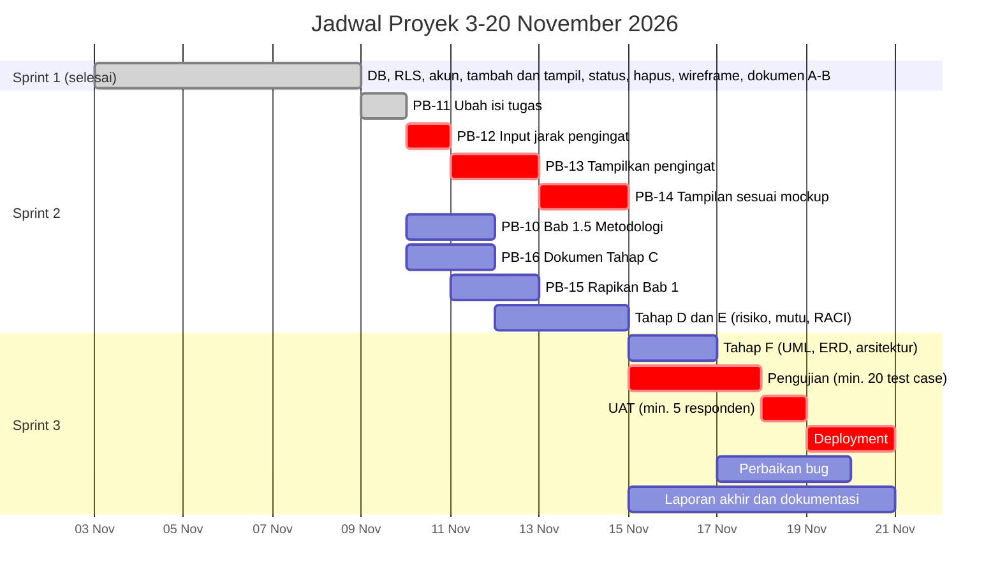

# Jadwal, Estimasi Usaha, dan Biaya (Tahap C)

Proyek: Platform Pengelolaan Tugas dan Pengingat Tenggat Waktu Mata Kuliah Berbasis Web
Status: DRAF, menunggu pemeriksaan Andri dan persetujuan tim
Dibuat: 10 November 2026 (Sprint 2, hari ke-2)
Catatan: susunan awal dibuat dengan bantuan AI dari dokumen yang sudah ada (SRS, User Stories, Product Backlog, WBS, papan sprint), lalu diperiksa tim. Angka yang bertanda **asumsi** atau **usulan** belum disepakati tim.

## 1. Dasar perencanaan
- Periode proyek: 3 sampai 20 November 2026, tiga sprint masing-masing 6 hari (Sprint 1: 3-8 Nov, Sprint 2: 9-14 Nov, Sprint 3: 15-20 Nov).
- Angka 18 hari disepakati tim; dosen pengampu menyerahkan durasi sprint kepada tim (sebelumnya disepakati 14 hari).
- Tim: Andre (PM, Developer), Jhon (Developer frontend, Tester), Andri (Analis, dokumentasi, UI/UX, Tester).
- Metodologi: Agile/Scrum. Pelacakan lewat papan sprint GitHub Projects.

## 2. Estimasi usaha (story point)

### 2.1 Metode
Estimasi relatif memakai story point dengan skala Fibonacci (1, 2, 3, 5, 8). Acuan: item "Ubah status tugas" = 2 SP. Item lain dibandingkan dengan acuan itu. Nilai awal dari draf ini perlu disepakati bertiga (planning poker sederhana) sebelum dianggap final.

**Catatan kejujuran:** item Sprint 1 (nomor 1-7) diestimasi setelah selesai, jadi nilainya bersifat retrospektif dan hanya dipakai untuk menghitung velocity, bukan sebagai prediksi yang sudah terbukti.

### 2.2 Estimasi per item backlog

| No | Item backlog | User story | Prioritas | SP (usulan) | Sprint selesai/rencana | Kartu |
|----|--------------|------------|-----------|-------------|------------------------|-------|
| 1 | Skema database dan aturan RLS | US-09 | Must | 5 | 1 (selesai) | PB-01, PB-02 |
| 2 | Daftar, masuk, dan keluar akun | US-01 | Must | 5 | 1 (selesai) | PB-03 |
| 3 | Tambah dan tampil daftar tugas | US-02, US-03 | Must | 5 | 1 (selesai) | PB-04 |
| 4 | Wireframe dan mockup halaman utama dan form tugas | pendukung desain | Should | 3 | 1 (selesai) | PB-05 |
| 5 | Dokumen Tahap A dan B | pendukung dokumentasi | Must | 5 | 1 (selesai sebagai draf) | PB-06 |
| 6 | Ubah status tugas | US-06 | Must | 2 | 1 (selesai lebih awal) | PB-07 |
| 7 | Hapus tugas | US-05 | Must | 2 | 1 (selesai lebih awal) | PB-08 |
| 8 | Ubah isi tugas | US-04 | Should | 3 | 2 (selesai 9 Nov) | PB-11 |
| 9 | Atur jarak waktu pengingat | US-07 | Must | 3 | 2 | PB-12 |
| 10 | Tampilkan pengingat di dalam aplikasi | US-08 | Must | 5 | 2 | PB-13 |
| 11 | Tampilan aplikasi sesuai mockup (HTML/CSS) | pendukung desain | Should | 5 | 2 | PB-14 |
| 12 | Pengujian (minimal 20 test case) dan UAT | semua | Must | 8 | 3 | belum ada kartu |
| 13 | Perbaikan bug dan deployment | semua | Must | 5 | 3 | belum ada kartu |
| | **Total** | | | **56** | | |

Item 11 (PB-14) belum ada di Product Backlog 2-5. Item ini ditambahkan pada Sprint 2 dan perlu dicatat sebagai change request (lihat bagian 6).

Pekerjaan dokumen di luar backlog produk (PB-10 Bab 1.5, PB-15 rapikan Bab 1, PB-16 dokumen Tahap C, serta Tahap D sampai J) dilacak di papan sprint dan tidak diberi story point.

### 2.3 Ringkasan per sprint

| Sprint | Periode | SP direncanakan | Isi |
|--------|---------|-----------------|-----|
| Sprint 1 | 3-8 Nov | 27 (selesai) | Item 1-7. Item 6 dan 7 semula dijadwalkan Sprint 2, selesai lebih awal |
| Sprint 2 | 9-14 Nov | 16 | Item 8-11 |
| Sprint 3 | 15-20 Nov | 13 | Item 12-13 |
| **Total** | | **56** | |

Velocity Sprint 1 = 27 SP (retrospektif). Velocity Sprint 2 dan 3 dihitung dari kartu yang benar-benar selesai, bukan dari angka rencana.

## 3. Rencana rilis

| Rilis | Waktu | Isi | Status |
|-------|-------|-----|--------|
| Rilis 1 | akhir Sprint 1 (8 Nov) | Database dan RLS, akun, tambah dan tampil tugas, ubah status, hapus | Selesai |
| Rilis 2 | akhir Sprint 2 (14 Nov) | Ubah isi tugas, jarak pengingat, tampilan pengingat, tampilan sesuai mockup | Direncanakan |
| Rilis 3 | akhir Sprint 3 (20 Nov) | Produk teruji, hasil UAT, perbaikan bug, ter-deploy | Direncanakan |

## 4. Jadwal dan Gantt chart

Gantt di bawah dibuat dengan Mermaid, yang tampil otomatis di GitHub. Pekerjaan Sprint 1 digambar sebagai satu blok karena tanggal selesai tiap kartu tidak dicatat per hari.

Tanggal pada Sprint 2 dan 3 adalah **rencana (usulan)**, bukan data realisasi.

## 5. Jalur kritis

Jalur kritis adalah rangkaian pekerjaan berurutan yang bila terlambat sehari akan menunda penyelesaian proyek sehari.

| Urutan | Pekerjaan | Pendahulu | Durasi | Rencana |
|--------|-----------|-----------|--------|---------|
| 1 | PB-12 Input jarak pengingat | - | 1 hari | 10 Nov |
| 2 | PB-13 Tampilkan pengingat | PB-12 (nilai pengingat harus tersimpan dulu) | 2 hari | 11-12 Nov |
| 3 | PB-14 Tampilan sesuai mockup | PB-13 (agar ID elemen tidak berubah saat fitur dikerjakan) | 2 hari | 13-14 Nov |
| 4 | Pengujian | PB-14 (fitur dan tampilan selesai) | 3 hari | 15-17 Nov |
| 5 | UAT | Pengujian | 1 hari | 18 Nov |
| 6 | Deployment | UAT | 2 hari | 19-20 Nov |

Total jalur kritis: 1 + 2 + 2 + 3 + 1 + 2 = 11 hari, dari 10 sampai 20 November. Jalur ini **tidak punya cadangan waktu (float = 0)**.

Pekerjaan di luar jalur kritis (PB-10, PB-15, PB-16, Tahap D sampai F, laporan akhir, perbaikan bug) punya cadangan waktu, tetapi dikerjakan orang yang sama dengan pekerjaan kritis sehingga harus diatur agar tidak bentrok.

Risiko jalur kritis: PB-12, PB-13, dan PB-14 semuanya dipegang Jhon dalam 5 hari. Bila PB-14 terlambat, pilihan yang tersedia adalah mengerjakan versi tampilan yang lebih sederhana dan mencatatnya di laporan. Keputusan ini perlu dibuat bertiga.

## 6. Perubahan terhadap rencana awal (untuk Change Request Log)

| No | Perubahan | Tanggal | Alasan |
|----|-----------|---------|--------|
| 1 | Durasi proyek 14 hari menjadi 18 hari | (isi tanggal dari catatan tim) | Perlu waktu pengujian dan UAT; durasi sprint diserahkan dosen pengampu kepada tim |
| 2 | Item 6 dan 7 (ubah status, hapus) dikerjakan di Sprint 1 | 5-8 Nov (sesuai riwayat commit) | Selesai lebih awal dari jadwal |
| 3 | Kartu PB-09 sampai PB-16 ditambahkan di papan | 8 Nov | Kartu Sprint 2 dibuat setelah Sprint 1 berjalan |
| 4 | Item 11 (PB-14, tampilan sesuai mockup) ditambahkan ke backlog | 8 Nov | Mockup selesai di Sprint 1 dan perlu diterapkan |

Catatan: sebelum dipakai di Bab 7, tanggal dan isi tabel ini dicocokkan dengan riwayat papan sprint dan komentar kartu.

## 7. Rencana anggaran biaya (RAB)

**Seluruh angka di bagian ini adalah asumsi untuk simulasi manajemen proyek, bukan pengeluaran nyata.** Proyek ini tidak membayar tenaga kerja dan memakai layanan gratis. Angka tarif dan jam rencana perlu disepakati tim dan dapat diubah sebelum dokumen final.

### 7.1 Biaya tenaga kerja (asumsi)

| Anggota | Peran | Tarif per jam (asumsi) | Jam rencana (asumsi) | Biaya |
|---------|-------|------------------------|----------------------|-------|
| Andre | PM, Developer | Rp60.000 | 40 | Rp2.400.000 |
| Jhon | Developer frontend, Tester | Rp50.000 | 35 | Rp1.750.000 |
| Andri | Analis, dokumentasi, UI/UX, Tester | Rp45.000 | 35 | Rp1.575.000 |
| **Subtotal tenaga kerja** | | | **110** | **Rp5.725.000** |

### 7.2 Biaya non-tenaga kerja (asumsi)

| Komponen | Biaya |
|----------|-------|
| Supabase paket gratis | Rp0 |
| Hosting gratis | Rp0 |
| Repositori GitHub (private, gratis) | Rp0 |
| Kuota internet selama proyek (3 orang x Rp50.000) | Rp150.000 |
| **Subtotal non-tenaga kerja** | **Rp150.000** |

### 7.3 Ringkasan

| Komponen | Jumlah |
|----------|--------|
| Budget at Completion (BAC) = tenaga kerja + non-tenaga kerja | Rp5.875.000 |
| Cadangan kontinjensi 10% dari BAC | Rp587.500 |
| **Total anggaran dengan cadangan** | **Rp6.462.500** |

BAC ini menjadi dasar analisis EVM pada Tahap G. Nilai PV per sprint ditetapkan saat dokumen EVM disusun. Jam aktual dicatat apa adanya di log kerja dan tidak harus sama dengan jam rencana; selisihnya akan terlihat pada CPI.

## 8. Hal yang perlu diputuskan tim
1. Setuju atau tidak dengan nilai story point di bagian 2.2.
2. Setuju atau tidak dengan tarif dan jam rencana di bagian 7.
3. Bila PB-14 terlambat: mockup penuh atau versi sederhana.
4. Selesai: dosen pengampu menyerahkan durasi sprint kepada tim (bukti chat WhatsApp).