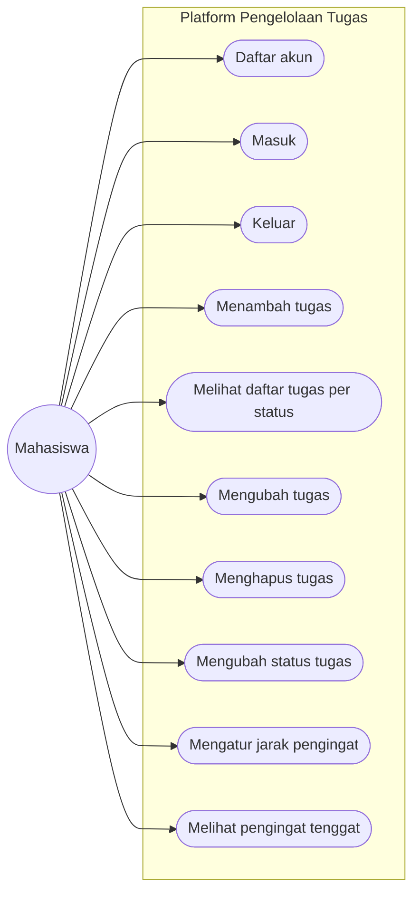
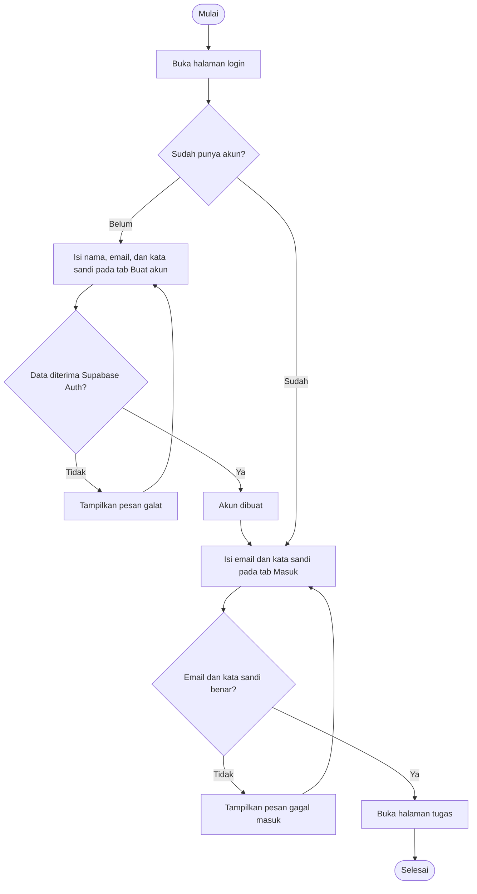
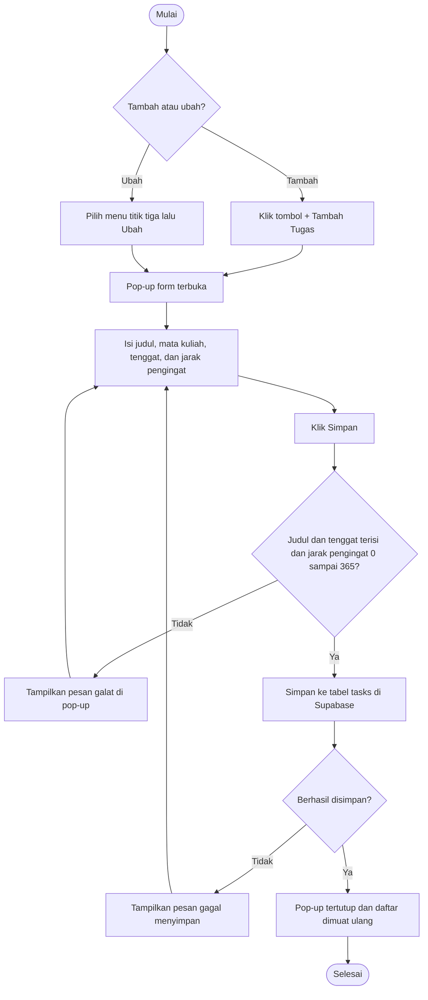
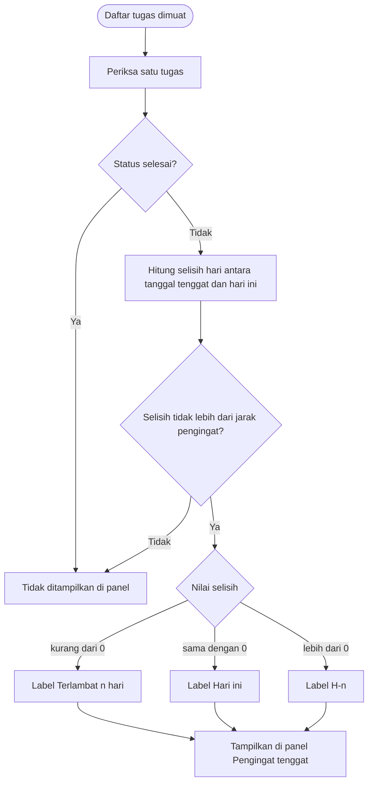
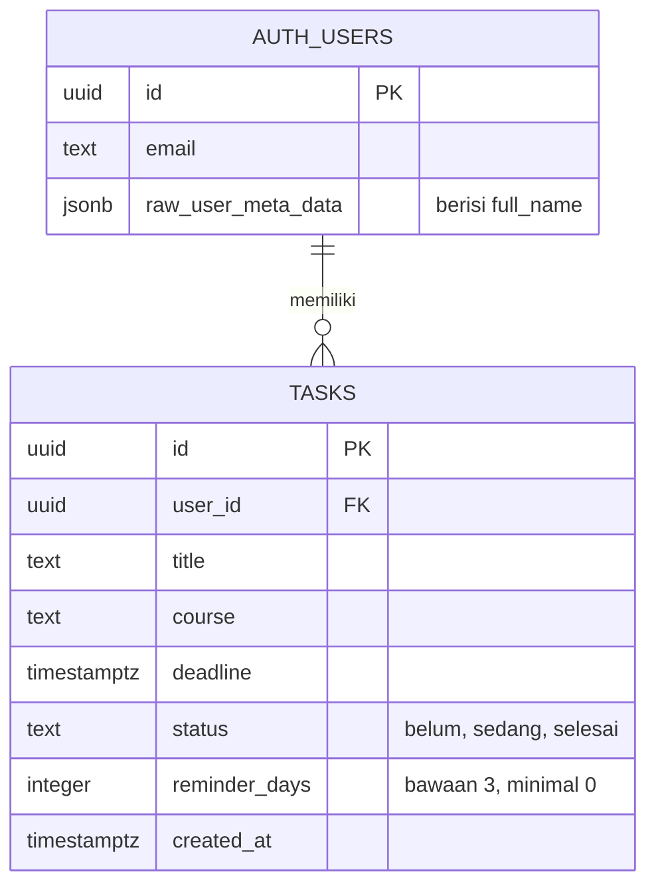
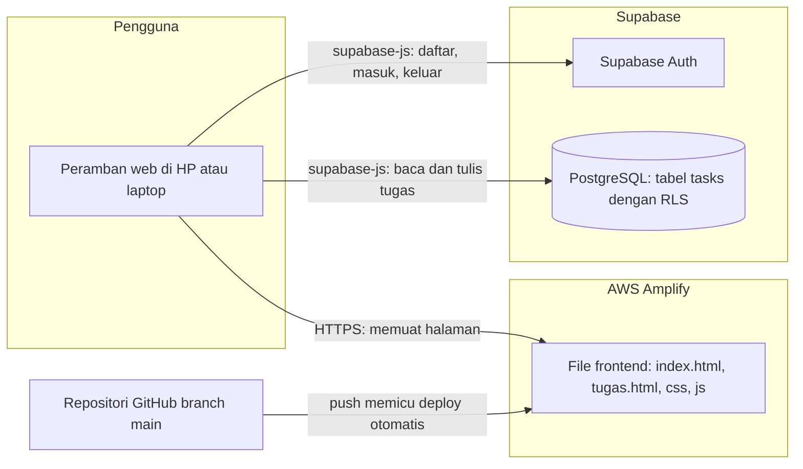
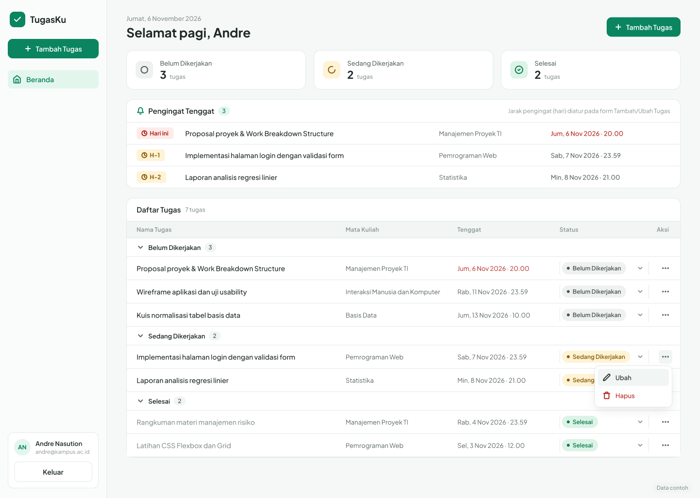
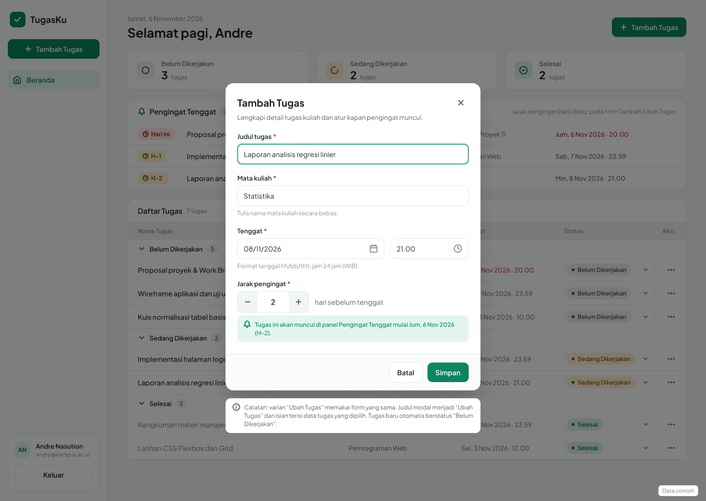
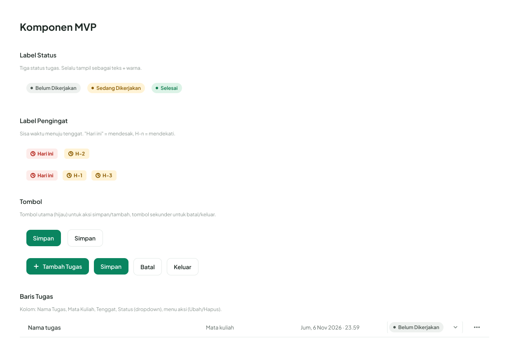

# Desain Sistem (Tahap F)

Proyek: Platform Pengelolaan Tugas dan Pengingat Tenggat Waktu Mata Kuliah Berbasis Web
Kartu: PB-21
Dibuat: 18 November 2026 (Sprint 3)
Catatan: diagram disusun dengan bantuan AI berdasarkan kode aplikasi dan struktur database proyek, lalu diperiksa tim. Diagram ditulis dalam format Mermaid sehingga tergambar otomatis saat dibuka di GitHub.

## 1. Use Case Diagram

Aktor tunggal adalah mahasiswa. Seluruh use case selain daftar akun dan masuk hanya dapat dilakukan setelah pengguna masuk.

## 2. Activity Diagram

### 2.1 Daftar akun dan masuk

### 2.2 Menambah atau mengubah tugas

### 2.3 Menentukan tugas yang tampil di panel pengingat

Jarak pengingat bawaan adalah 3 hari dan dapat diubah per tugas.

## 3. Entity Relationship Diagram (ERD)

Keterangan:
- AUTH_USERS adalah tabel akun bawaan Supabase Auth. Nama lengkap disimpan di metadata akun (raw_user_meta_data, kunci full_name) saat pendaftaran melalui sb.auth.signUp pada auth.js, sehingga tidak diperlukan tabel profil terpisah.
- Satu pengguna dapat memiliki banyak tugas, dan setiap tugas dimiliki tepat satu pengguna (TASKS.user_id merujuk AUTH_USERS.id).
- Row Level Security pada tabel tasks memastikan pengguna hanya dapat membaca, menambah, mengubah, dan menghapus baris dengan user_id miliknya sendiri (diuji pada TC-22 dan TC-23).

## 4. Arsitektur Sistem

Penjelasan:
- Aplikasi berupa halaman statis (HTML, CSS, JavaScript) tanpa server aplikasi sendiri.
- Peramban berkomunikasi langsung dengan Supabase memakai pustaka supabase-js dan publishable key.
- Keamanan data dijaga oleh Supabase Auth (identitas pengguna) dan Row Level Security (hak akses per baris).

## 5. Wireframe dan Mockup

Mockup dibuat di Figma oleh Andri, terdiri atas tiga frame: Beranda (daftar tugas), Pop-up Tambah Tugas, dan Komponen MVP (label status, label pengingat, tombol, baris tugas). Gambar mockup disimpan di folder docs.

Perbedaan mockup dengan aplikasi:
| Bagian mockup | Status di aplikasi |
|---------------|--------------------|
| Tema warna, kartu hitungan status, label status, panel pengingat | Diterapkan |
| Menu aksi titik tiga (Ubah dan Hapus) | Diterapkan, tanpa ikon |
| Form tambah dan ubah tugas sebagai pop-up | Diterapkan |
| Daftar tugas dikelompokkan per status dan dapat dilipat | Diterapkan |
| Sidebar, sapaan, dan tanggal | Diterapkan pada 18 November (tampil di layar lebar, disembunyikan di HP) |
| Tampilan kolom seperti tabel, tombol plus-minus jarak pengingat, ikon pada menu aksi | Tidak diterapkan karena keterbatasan waktu |
| Halaman login | Tidak ada di mockup; didesain terpisah pada 15 November (desain dengan bantuan Manus) |