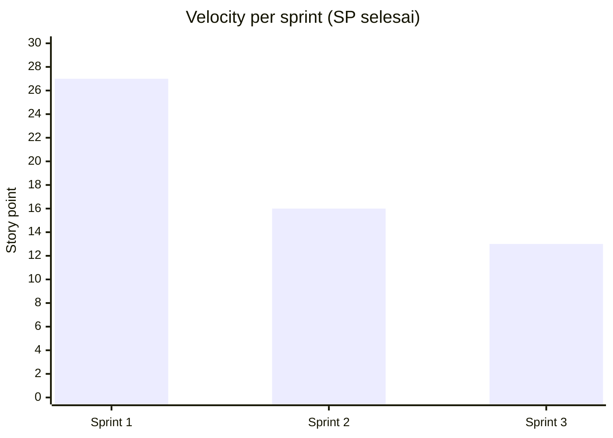
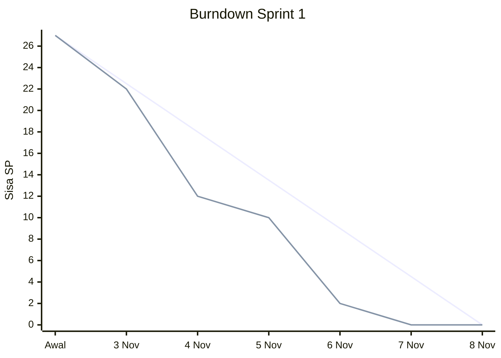
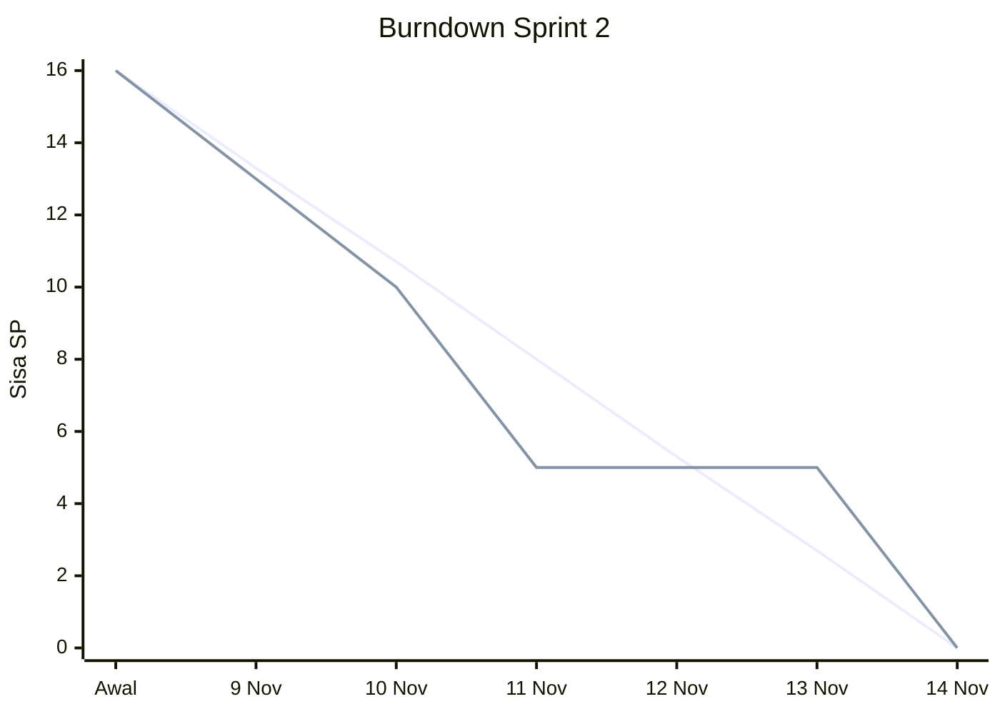
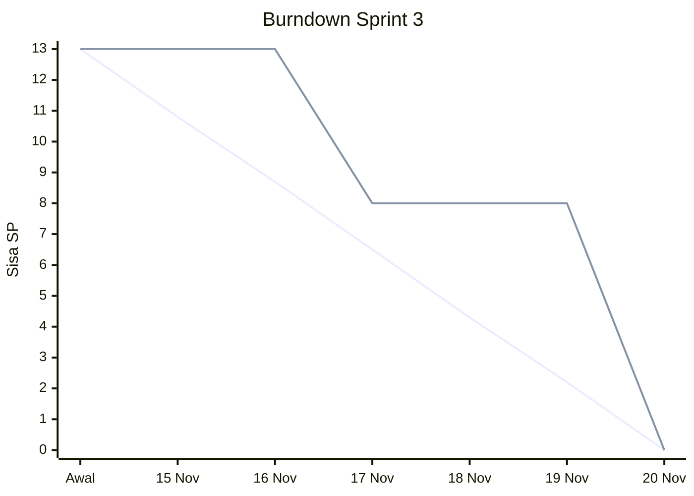

# Pemantauan Proyek: Laporan Kemajuan, Velocity, Burndown, EVM, dan Change Request (Tahap G)

Proyek: Platform Pengelolaan Tugas dan Pengingat Tenggat Waktu Mata Kuliah Berbasis Web
Kartu: PB-25
Tanggal status: 20 November 2026 (akhir Sprint 3)
Catatan: dokumen disusun dengan bantuan AI dari data proyek yang tercatat (riwayat commit Git, papan sprint, dan dokumen 3-1), lalu diperiksa tim. Metode dan keterbatasan data dijelaskan pada bagian 1 dan 9.

## 1. Sumber data dan metode
- Story point (SP) dan BAC diambil dari dokumen 3-1: total 56 SP (Sprint 1 = 27, Sprint 2 = 16, Sprint 3 = 13) dan BAC Rp5.875.000.
- Tanggal selesai tiap item diambil dari tanggal commit di riwayat Git.
- Jam kerja aktual tidak dicatat harian selama proyek. Jam kerja pada dokumen ini adalah perkiraan yang dihitung dari jam commit dengan aturan:
  1. Commit seorang anggota pada hari yang sama dikelompokkan menjadi satu sesi bila jaraknya tidak lebih dari 3 jam.
  2. Jam satu sesi = jarak commit pertama sampai terakhir ditambah 1 jam untuk pekerjaan sebelum commit pertama (membaca, menguji, menyiapkan). Sesi dengan satu commit dihitung 1 jam. Hasil dibulatkan ke 0,5 jam.
  3. Pada hari tim bekerja bersama di satu tempat (10, 12, 14, 16, dan 18 November) sesi bersama dihitung untuk ketiga anggota.
- Pekerjaan tanpa commit (desain di Figma, diskusi, penyebaran dan pengisian Google Form, pembimbingan) tidak tercatat, sehingga jam kerja dan biaya aktual pada dokumen ini lebih rendah dari kenyataan.

## 2. Laporan kemajuan per periode

### 2.1 Periode 1: Sprint 1 (3-8 November 2026)
| Aspek | Keterangan |
|-------|------------|
| Rencana | Item 1-7: database dan RLS, akun, tambah dan tampil tugas, mockup, dokumen Tahap A dan B, ubah status, hapus tugas (27 SP) |
| Realisasi | Seluruh item selesai (27 SP). Ubah status dan hapus tugas selesai lebih awal dari rencana awal |
| Kendala | Item Sprint 1 diestimasi setelah selesai (retrospektif) |
| Status | Sesuai rencana |

### 2.2 Periode 2: Sprint 2 (9-14 November 2026)
| Aspek | Keterangan |
|-------|------------|
| Rencana | Item 8-11: ubah isi tugas, jarak pengingat, panel pengingat, tampilan sesuai mockup (16 SP) |
| Realisasi | Seluruh item selesai (16 SP). Dokumen Tahap C, D, E, metodologi, dan review Sprint 2 juga selesai |
| Kendala | 9 November dua anggota berhalangan (PB-11 dikerjakan Andre); kesalahan operasi Git; koneksi internet |
| Status | Sesuai rencana |

### 2.3 Periode 3: Sprint 3 (15-20 November 2026)
| Aspek | Keterangan |
|-------|------------|
| Rencana | Item 12-13: pengujian dan UAT, perbaikan bug dan deployment (13 SP) |
| Realisasi | 24 test case lulus (16 Nov), BUG-01 diperbaiki (16 Nov), deployment ke AWS Amplify dan domain pengelolatugas.my.id (17 Nov), UAT 8 responden dengan 100% menilai aplikasi membantu (20 Nov). Tambahan: desain ulang halaman login, sidebar dan sapaan, dokumen desain sistem |
| Kendala | 15 November tidak ada aktivitas di siang hari; UAT bergeser dari 18 ke 20 November |
| Status | Item produk selesai; dokumen laporan akhir dikerjakan pada hari terakhir |

## 3. Velocity

| Sprint | SP direncanakan | SP selesai (velocity) |
|--------|-----------------|------------------------|
| Sprint 1 | 27 | 27 |
| Sprint 2 | 16 | 16 |
| Sprint 3 | 13 | 13 |
| Rata-rata | | 18,7 |

Velocity menurun karena SP direncanakan per sprint memang berbeda, bukan karena tim melambat. Pada Sprint 2 dan 3 sebagian besar waktu juga dipakai untuk dokumen proyek yang tidak diberi story point.

## 4. Burndown chart
Nilai adalah sisa SP pada akhir hari. Garis pertama pada grafik adalah garis ideal, garis kedua adalah realisasi.

### 4.1 Sprint 1 (27 SP)
| Hari | Awal | 3 Nov | 4 Nov | 5 Nov | 6 Nov | 7 Nov | 8 Nov |
|------|------|-------|-------|-------|-------|-------|-------|
| Ideal | 27 | 22,5 | 18 | 13,5 | 9 | 4,5 | 0 |
| Realisasi | 27 | 22 | 12 | 10 | 2 | 0 | 0 |

Item selesai: 3 Nov database dan RLS (5); 4 Nov akun (5) serta tambah dan tampil tugas (5); 5 Nov ubah status (2); 6 Nov dokumen Tahap A-B (5) dan mockup (3); 7 Nov hapus tugas (2).

### 4.2 Sprint 2 (16 SP)
| Hari | Awal | 9 Nov | 10 Nov | 11 Nov | 12 Nov | 13 Nov | 14 Nov |
|------|------|-------|--------|--------|--------|--------|--------|
| Ideal | 16 | 13,3 | 10,7 | 8 | 5,3 | 2,7 | 0 |
| Realisasi | 16 | 13 | 10 | 5 | 5 | 5 | 0 |

Item selesai: 9 Nov ubah isi tugas (3); 10 Nov jarak pengingat (3); 11 Nov panel pengingat (5); 14 Nov tampilan sesuai mockup (5, dikerjakan bertahap 12-14 Nov).

### 4.3 Sprint 3 (13 SP)
| Hari | Awal | 15 Nov | 16 Nov | 17 Nov | 18 Nov | 19 Nov | 20 Nov |
|------|------|--------|--------|--------|--------|--------|--------|
| Ideal | 13 | 10,8 | 8,7 | 6,5 | 4,3 | 2,2 | 0 |
| Realisasi | 13 | 13 | 13 | 8 | 8 | 8 | 0 |

Item selesai: 17 Nov perbaikan bug dan deployment (5; BUG-01 diperbaiki 16 Nov, deployment 17 Nov); 20 Nov pengujian dan UAT (8; pengujian selesai 16 Nov, UAT selesai 20 Nov). Item pengujian dan UAT dihitung selesai setelah kedua bagiannya selesai, sehingga grafik turun tajam di hari terakhir.

## 5. Jam kerja dan biaya aktual (perkiraan)

### 5.1 Sesi kerja dari riwayat commit
| Tanggal | Anggota | Jam commit | Jam dihitung |
|---------|---------|------------|--------------|
| 3 Nov | Andre | 10.07 dan 17.12 (dua sesi) | 2,0 |
| 4 Nov | Andre | 12.50-14.22 | 2,5 |
| 4 Nov | Jhon | 13.51-14.06 | 1,0 |
| 5 Nov | Andre | 22.34 | 1,0 |
| 6 Nov | Andri | 15.04-17.12 | 3,0 |
| 7 Nov | Jhon | 19.01 | 1,0 |
| 8 Nov | Jhon | 16.10 | 1,0 |
| 9 Nov | Andre | 21.06 | 1,0 |
| 10 Nov | Bertiga | 12.09-13.03 | 2,0 per orang |
| 11 Nov | Jhon | 21.28 | 1,0 |
| 12 Nov | Bertiga | 13.35-16.30 | 4,0 per orang |
| 13 Nov | Jhon | 19.07 | 1,0 |
| 14 Nov | Bertiga | 14.13-15.00 | 2,0 per orang |
| 15 Nov | Andre | 23.10-23.54 | 1,5 |
| 16 Nov | Bertiga | 14.49-15.17 | 1,5 per orang |
| 16 Nov | Andre | 21.47 | 1,0 |
| 17 Nov | Andre | 15.23-16.22 | 2,0 |
| 18 Nov | Bertiga | 13.04-13.33 | 1,5 per orang |
| 20 Nov | Andri | 16.03 | 1,0 |

### 5.2 Rekap jam dan biaya tenaga kerja
Tarif mengikuti asumsi RAB pada dokumen 3-1 (Andre Rp60.000, Jhon Rp50.000, Andri Rp45.000 per jam). Biaya non-tenaga kerja (kuota internet Rp150.000) dianggap terpakai rata Rp50.000 per sprint.

| Sprint | Andre (jam) | Jhon (jam) | Andri (jam) | Total jam | Biaya tenaga kerja | Non-tenaga kerja | Biaya aktual (AC) per sprint |
|--------|-------------|------------|-------------|-----------|--------------------|------------------|------------------------------|
| Sprint 1 | 5,5 | 3,0 | 3,0 | 11,5 | Rp615.000 | Rp50.000 | Rp665.000 |
| Sprint 2 | 9,0 | 10,0 | 8,0 | 27,0 | Rp1.400.000 | Rp50.000 | Rp1.450.000 |
| Sprint 3 | 7,5 | 3,0 | 4,0 | 14,5 | Rp780.000 | Rp50.000 | Rp830.000 |
| Total | 22,0 | 16,0 | 15,0 | 53,0 | Rp2.795.000 | Rp150.000 | Rp2.945.000 |

Total 53 jam ini jauh di bawah rencana 110 jam pada RAB. Selisih terutama berasal dari metode pencatatan (bagian 1), bukan bukti bahwa pekerjaan memang hanya 53 jam.

## 6. Earned Value Management (EVM)
- PV (planned value) kumulatif = BAC x SP direncanakan kumulatif / 56.
- EV (earned value) kumulatif = BAC x SP selesai kumulatif / 56.
- AC (actual cost) kumulatif dari bagian 5.2.
- SV = EV - PV, CV = EV - AC, SPI = EV / PV, CPI = EV / AC.

| Akhir periode | SP rencana kumulatif | SP selesai kumulatif | PV | EV | AC | SV | CV | SPI | CPI |
|---------------|----------------------|----------------------|----|----|----|----|----|-----|-----|
| Sprint 1 (8 Nov) | 27 | 27 | Rp2.832.589 | Rp2.832.589 | Rp665.000 | Rp0 | Rp2.167.589 | 1,00 | 4,26 |
| Sprint 2 (14 Nov) | 43 | 43 | Rp4.511.161 | Rp4.511.161 | Rp2.115.000 | Rp0 | Rp2.396.161 | 1,00 | 2,13 |
| Sprint 3 (20 Nov) | 56 | 56 | Rp5.875.000 | Rp5.875.000 | Rp2.945.000 | Rp0 | Rp2.930.000 | 1,00 | 1,99 |

Interpretasi:
- SPI = 1,00 pada ketiga periode: seluruh item yang direncanakan di tiap sprint selesai di sprint tersebut, sehingga jadwal sesuai rencana pada tingkat sprint. Di dalam Sprint 3, penyelesaian item pengujian dan UAT tertunda ke hari terakhir (lihat burndown 4.3).
- CPI di atas 1 berarti biaya aktual lebih kecil dari nilai pekerjaan. Angka CPI ini tidak boleh dibaca sebagai efisiensi nyata, karena AC dihitung dari jam commit yang lebih rendah dari jam kerja sebenarnya. CPI yang turun dari 4,26 ke 1,99 menunjukkan porsi jam kerja yang tercatat bertambah pada Sprint 2 dan 3, ketika tim lebih sering bekerja bersama.
- Pelajaran: jam kerja perlu dicatat harian sejak awal proyek agar CPI dapat diandalkan.

## 7. Change Request Log
| No | Tanggal | Perubahan | Alasan | Dampak |
|----|---------|-----------|--------|--------|
| 1 | Sebelum 8 Nov (dicatat di review Sprint 1) | Durasi proyek 14 hari menjadi 18 hari (3 sprint x 6 hari) | Butuh waktu pengujian dan UAT; dosen menyerahkan durasi sprint kepada tim | Jadwal 3-20 November |
| 2 | 5-7 Nov | Ubah status dan hapus tugas dikerjakan di Sprint 1 | Selesai lebih awal | Sprint 1 menjadi 27 SP |
| 3 | 8 Nov | Kartu PB-09 sampai PB-16 dan item tampilan sesuai mockup (PB-14) ditambahkan | Persiapan Sprint 2; mockup perlu diterapkan | Sprint 2 menjadi 16 SP |
| 4 | 12 Nov | Kartu PB-17 dan PB-18 (dokumen Tahap D dan E) ditambahkan | Ketentuan dokumen dari tugas proyek | Beban dokumen Sprint 2 bertambah |
| 5 | 12 Nov | PB-14 tetap satu kartu, dikerjakan bertahap sampai 14 Nov | Tampilan belum sesuai mockup | Selesai 14 Nov |
| 6 | 14 Nov | Kartu PB-19 (review Sprint 2) ditambahkan; PB-15 dibawa ke Sprint 3 | Penutupan sprint | Sisa PB-15 pindah ke Sprint 3 |
| 7 | 15 Nov | Kartu PB-20 sampai PB-29 ditambahkan | Perencanaan Sprint 3 | Seluruh pekerjaan Sprint 3 terlacak |
| 8 | 15 Nov | Desain ulang halaman login (tidak ada di mockup) | Tampilan login dinilai terlalu polos | Masuk PB-23 |
| 9 | 17 Nov | Platform deployment: Netlify dipertimbangkan, Vercel dicoba (404), dipilih AWS Amplify dan domain pengelolatugas.my.id | Batas kredit Netlify dan pengaturan folder pada Vercel | Aplikasi online 17 Nov |
| 10 | 18 Nov | Sidebar dan sapaan ditambahkan setelah pengujian | Menyesuaikan dengan mockup | Diuji ulang lewat UAT 20 Nov |
| 11 | 18 Nov | UAT bergeser dari 18 ke 20 November | Responden tidak tersedia pada sore hari | Hasil UAT masuk hari terakhir |
| 12 | 20 Nov | Instrumen UAT menjadi Google Form daring | Waktu terbatas untuk observasi langsung | 8 responden mengisi |

## 8. Ringkasan riwayat commit
| Sprint | Andre | Jhon | Andri | Total |
|--------|-------|------|-------|-------|
| Sprint 1 | 5 | 4 | 6 | 15 |
| Sprint 2 | 2 | 7 | 6 | 15 |
| Sprint 3 | 10 | 3 | 3 | 16 |
| Total | 17 | 14 | 15 | 46 |

Catatan:
- Akun "Andreyal Nasution" dan "AndreyalNasution" adalah orang yang sama (Andre); akun "andresitepu088-blip" adalah Andri; akun "Jhon Manik" adalah Jhon.
- Beberapa pekerjaan dijalankan di laptop anggota lain, misalnya kode tasks.js untuk tampilan PB-14 di-commit dari laptop Jhon dan file tampilan login (milik Jhon) diubah dari laptop Andre. Hal ini dicatat di komentar kartu.
- Dua commit pada 17 November ("move index to root" dan "uncommit") dibuat saat mencoba deployment dan tidak memakai nomor kartu.
- Tahap 3a PB-14 (menu aksi titik tiga) tidak muncul sebagai commit terpisah di riwayat; perubahannya tercakup pada commit PB-14 tahap 3b tanggal 13 November.

## 9. Keterbatasan
1. Jam kerja dan biaya aktual dihitung dari riwayat commit, bukan log kerja harian, sehingga cenderung lebih rendah dari kenyataan.
2. Story point Sprint 1 ditetapkan secara retrospektif.
3. Pekerjaan dokumen di luar backlog produk tidak diberi story point, sehingga tidak tampak pada velocity dan burndown.